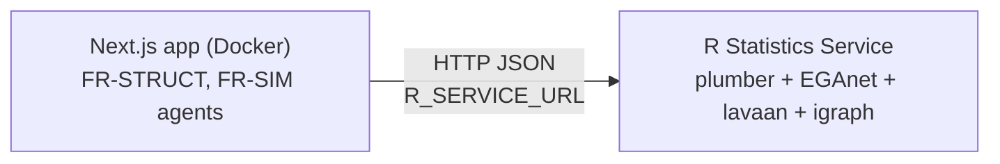

# Design Document

## Overview

The R Statistics Service is a plumber-based JSON HTTP API for psychometric scale development. It provides two statistical endpoints:

- `/ega`: structural semantic screening with EGAnet (UVA redundancy removal, bootEGA stability removal, NMI against the intended structure), following the AI-GENIE methodology.
- `/cfa`: confirmatory factor analysis with lavaan, used by the technical rehearsal (smoke test) on simulated persona responses.

The service supports the structural screening agent (FR-STRUCT) and the simulation agent (FR-SIM). It runs as a separate process from the Next.js app and communicates over HTTP JSON. The request/response contract is defined in `.kiro/steering/03-statistics-contract.md`.

**Design principles**

- Every psychometric threshold and procedure parameter arrives in the request `config`, loaded by the client from `app-config/psychometric-procedure.yaml`. The service has no defaults for them.
- A null or missing config value is rejected with HTTP 400 and an actionable message.
- Embeddings are transposed before EGA so that items become variables (AI-GENIE).
- Wrapper argument names and result field names follow the output of `r-service/probe.R`, not memory.
- Tests check numbers against planted structure or a lavaan reference, not just exit codes.

## Architecture

### Deployment



**Binding and environment variables**

| Variable         | Purpose                      | Default     |
| ---------------- | ---------------------------- | ----------- |
| `R_SERVICE_HOST` | Host to bind                 | `127.0.0.1` |
| `R_SERVICE_PORT` | Port to bind                 | `8000`      |
| `R_SERVICE_CORS` | Add CORS headers if `"true"` | unset (off) |

Start command: `Rscript r-service/api.R`.

### File structure

```
r-service/
├── api.R
├── probe.R
├── config/
│   └── loader.R
├── validation/
│   └── request_validator.R
├── ega/
│   ├── pipeline.R
│   ├── uva.R
│   ├── bootega.R
│   └── nmi.R
├── cfa/
│   ├── pipeline.R
│   ├── model_builder.R
│   ├── estimator.R
│   └── extractor.R
├── logging/
│   └── logger.R
├── tests/
│   ├── run_all.R
│   ├── helpers.R
│   ├── test_ega.R
│   ├── test_cfa.R
│   ├── test_holzinger.R
│   ├── test_errors.R
│   ├── test_properties.R
│   ├── generate_fixtures.R
│   └── fixtures/
│       ├── ega_input.json
│       ├── ega_expected.json
│       ├── cfa_input.json
│       └── cfa_expected.json
└── README.md
```

| File                             | Responsibility                                                                                                                      |
| -------------------------------- | ----------------------------------------------------------------------------------------------------------------------------------- |
| `api.R`                          | Load packages (exit 1 listing missing ones), source modules, define routes, CORS, bind host/port                                    |
| `probe.R`                        | Development probe: print package versions and `str()` of EGAnet/lavaan results                                                      |
| `config/loader.R`                | `validate_config()`: reject missing or null config fields                                                                           |
| `validation/request_validator.R` | `validate_ega_request()`, `validate_cfa_request()`: schema and dimension checks                                                     |
| `ega/pipeline.R`                 | `execute_ega_pipeline()`: orchestrates transpose → UVA → bootEGA → NMI → response                                                   |
| `ega/uva.R`                      | `run_uva_loop()`: repeated `EGAnet::UVA` until no redundant items                                                                   |
| `ega/bootega.R`                  | `run_bootega_loop()`: repeated `EGAnet::bootEGA` + `itemStability` until all items stable                                           |
| `ega/nmi.R`                      | `compute_nmi()`: NMI via `igraph::compare(method = "nmi")`, NA handling                                                             |
| `cfa/pipeline.R`                 | `execute_cfa_pipeline()`: orchestrates syntax → fit → extraction → response                                                         |
| `cfa/model_builder.R`            | `build_lavaan_model()`: lavaan syntax from `model_specification.factors`                                                            |
| `cfa/estimator.R`                | `run_cfa()`: `lavaan::cfa` with WLSMV or ML, warning capture, convergence check                                                     |
| `cfa/extractor.R`                | Fit indices, standardized loadings, factor correlations                                                                             |
| `logging/logger.R`               | JSON-line logging to stdout (normal) and stderr (errors)                                                                            |
| `tests/run_all.R`                | Run all test files, print summary, exit 0 / 1                                                                                       |
| `tests/helpers.R`                | `assert_true`, `assert_near`, `assert_in_range`, `assert_set_equal`, `assert_equal`                                                 |
| `tests/test_ega.R`               | EGA fixture test                                                                                                                    |
| `tests/test_cfa.R`               | CFA planted-loading fixture test                                                                                                    |
| `tests/test_holzinger.R`         | HolzingerSwineford1939 reference test against direct `lavaan::cfa()`                                                                |
| `tests/test_errors.R`            | Validation and error-path tests (400/500, request_id)                                                                               |
| `tests/test_properties.R`        | Property-based tests for three pure functions (`compute_nmi`, `validate_config`, `build_lavaan_model`), via `testthat` + `hedgehog` |
| `tests/generate_fixtures.R`      | Generate fixture inputs and record expected outputs                                                                                 |
| `README.md`                      | Packages with minimum versions, install, start, env vars, tests, curl health check, layout                                          |

## Components and Interfaces

### Service initialization (`api.R`)

1. Check required packages: plumber, EGAnet, lavaan, igraph, jsonlite, uuid. If any is missing, write the list to stderr and exit with code 1.
2. Source `config/`, `validation/`, `ega/`, `cfa/`, `logging/`.
3. Read `R_SERVICE_HOST` and `R_SERVICE_PORT` (defaults above).
4. Define routes `GET /health`, `POST /ega`, `POST /cfa`, all with the JSON serializer (`Content-Type: application/json`).
5. If `R_SERVICE_CORS == "true"`, add CORS headers via a filter.
6. Run the plumber router on host and port.

`GET /health` returns `{"status": "ok", "timestamp": "<ISO8601>"}` with HTTP 200.

### Route handler pattern

Both POST handlers take `(req, res)`, generate a UUID `request_id`, record the start time, and wrap the pipeline in `tryCatch`. The HTTP status is chosen by condition class only (see Error Handling).

### `/ega` flow

```r
validate_ega_request(body)                     # throws validation_error
validate_config(config, required_fields)       # throws validation_error
execute_ega_pipeline(body)                     # -> response list
run_uva_loop(data, config)                     # -> removed_items, removed_wto_scores, retained_data
run_bootega_loop(data, config)                 # -> removed_items, removed_stability_scores, retained_data, stability_per_item
compute_nmi(detected, intended)                # -> numeric
log_ega_execution(body, result, request_id, duration_ms)
```

1. **Parse JSON.** `jsonlite::fromJSON(req$postBody)`. A parse failure is re-thrown as a `validation_error` with message `"Invalid JSON: <parser message>"`.
2. **Validate request.** `validate_ega_request()` checks required fields (`embeddings`, `item_ids`, `intended_dimensions`, `config`), that `embeddings` is a numeric matrix with at least 2 rows (a list of rows is bound with `rbind`), and that `item_ids` and `intended_dimensions` lengths equal the embeddings row count.
3. **Validate config.** `validate_config()` requires all eight fields: `wto_threshold`, `stability_threshold`, `boot_iterations`, `network_method`, `community_algorithm`, `random_seed`, `uva_method`, `bootstrap_type`. Missing → `"config.<field> is missing"`; null → `"config.<field> is null; owner decision required"`.
4. **Transpose.** `t(embeddings)` so rows are embedding dimensions (observations) and columns are items (variables), per AI-GENIE. Column names are set to `item_ids`.
5. **Initial NMI.** Run `EGAnet::EGA` on the full transposed matrix with `model` and `algorithm` from config. Compute `nmi.initial` from its community membership (`wc`) against `intended_dimensions + 1` (the request is 0-indexed, NMI comparison uses 1-indexed labels).
6. **UVA loop.** Call `EGAnet::UVA` with `cut.off` and `uva.method` from config, plus `reduce = TRUE`, `reduce.method = "remove"`, `auto = TRUE`, `verbose = FALSE`. Items present before but absent from the reduced data are added to `removed_items`, with their wTO score recorded. Repeat on the reduced data until a pass removes nothing.
7. **bootEGA loop.** Call `EGAnet::bootEGA` on the UVA-retained data with `model`, `algorithm`, `iter`, `type`, `seed` from config and `verbose = FALSE`. Obtain per-item stability through `EGAnet::itemStability` (exact call and result field path as shown by `probe.R`). Remove every item with stability below `stability_threshold`, record its score, and repeat until all remaining items are stable. The last pass's scores become `stability_per_item`.
8. **Final NMI.** Run `EGAnet::EGA` on the retained data and compute `nmi.final` against `intended_dimensions` subset to the retained items (matched by item ID), again `+ 1`.
9. **NA handling in NMI.** `compute_nmi()` requires equal-length vectors, drops positions where either `detected` (`wc`) or `intended` is NA, warns with the count dropped, errors if nothing remains, then calls `igraph::compare(detected, intended, method = "nmi")`.
10. **Response.** Build the success response (see Data Models). `uva.reason` is `"weighted topological overlap >= <wto_threshold>"`; `bootega.reason` is `"stability < <stability_threshold> over <boot_iterations> iterations"`. Both values are interpolated from the request config. Log and return HTTP 200.

### `/cfa` flow

```r
validate_cfa_request(body)                              # throws validation_error
execute_cfa_pipeline(body)                              # -> response list
build_lavaan_model(model_specification)                 # -> character syntax
run_cfa(model_syntax, response_df, item_ids, ordinal)   # -> fit, converged, warnings
extract_fit_indices(fit)                                # -> named list
extract_loadings(fit, model_specification)              # -> nested list
extract_factor_correlations(fit, model_specification)   # -> named list
log_cfa_execution(body, result, request_id, duration_ms)
```

1. **Parse JSON.** Same as `/ega`: parse failure → `validation_error`.
2. **Validate request.** Required fields `responses`, `item_ids`, `model_specification`, `ordinal`. `responses` must be an integer matrix (list of rows is bound with `rbind`). `item_ids` length must equal the column count. Every item in `model_specification.factors[*].items` must be in `item_ids`; missing ones are listed in the message.
3. **Build syntax.** One line per factor: `<name> =~ item_a + item_b + ...`, joined by newlines.
4. **Prepare data.** `responses` as a data frame with column names `item_ids`.
5. **Choose estimator and fit.** `std.lv = TRUE` in both cases (latent variances fixed to 1).
   - `ordinal = true` → `lavaan::cfa(..., ordered = item_ids, estimator = "WLSMV")`. The estimator is set explicitly, not left to lavaan's default for ordered data.
   - `ordinal = false` → `lavaan::cfa(..., estimator = "ML")`.
   - Warnings are captured with `withCallingHandlers` and muffled into a list.
   - Convergence is read with `lavaan::lavInspect(fit, "converged")`.
6. **Fit indices.** `lavaan::fitMeasures(fit, c("chisq", "df", "pvalue", "cfi", "tli", "rmsea", "rmsea.ci.lower", "rmsea.ci.upper", "srmr"))`, returned `unname()`d with `rmsea.ci.*` renamed to `rmsea_ci_lower` / `rmsea_ci_upper`.
7. **Loadings.** `lavaan::standardizedSolution(fit)` rows with `op == "=~"`, organized as `loadings[factor][item] = est.std`.
8. **Factor correlations.** Rows with `op == "~~"`, `lhs != rhs`, and both sides factor names. Keys are `"<lhs>_<rhs>"`. Empty object for single-factor models.
9. **Non-convergence.** Return HTTP 200 with `status: "warning"`, `message: "Model did not converge"`, `partial_fit_indices` (empty object if extraction fails) and `lavaan_warnings`.
10. **Success.** Return HTTP 200 with fit indices, loadings, factor correlations and captured warnings.

### Config field → package argument mapping

Every value below is read from the request `config`. There are no defaults in the service; a null or missing value returns HTTP 400 before any computation.

| Config field          | Used as                                                            | Notes                                                           |
| --------------------- | ------------------------------------------------------------------ | --------------------------------------------------------------- |
| `wto_threshold`       | `EGAnet::UVA(cut.off = ...)`                                       | Read from config                                                |
| `uva_method`          | `EGAnet::UVA(uva.method = ...)`                                    | Read from config                                                |
| `network_method`      | `EGAnet::EGA(model = ...)`, `EGAnet::bootEGA(model = ...)`         | Read from config                                                |
| `community_algorithm` | `EGAnet::EGA(algorithm = ...)`, `EGAnet::bootEGA(algorithm = ...)` | Read from config                                                |
| `boot_iterations`     | `EGAnet::bootEGA(iter = ...)`                                      | Read from config                                                |
| `bootstrap_type`      | `EGAnet::bootEGA(type = ...)`                                      | AI-GENIE uses `"resampling"`; the value still comes from config |
| `random_seed`         | `EGAnet::bootEGA(seed = ...)`, and EGA seeding where supported     | Read from config                                                |
| `stability_threshold` | Compared against `itemStability` per-item output                   | Item removed if stability < threshold                           |

Fixed (non-psychometric) arguments: `UVA(reduce = TRUE, reduce.method = "remove", auto = TRUE)`, `std.lv = TRUE` in lavaan, `verbose = FALSE`.

### Development probe (`probe.R`)

The probe runs before any EGAnet or lavaan wrapper is written, and again after package upgrades or unexpected missing fields.

- Prints `packageVersion()` for EGAnet, lavaan and igraph.
- Generates small sample data with a fixed seed.
- Runs `EGAnet::UVA`, `EGAnet::EGA`, `EGAnet::bootEGA`, `EGAnet::itemStability` (on the bootEGA result) and `lavaan::cfa` (ordinal, WLSMV) on that data.
- Prints `str()` and `names()` of each result, including `ega$wc`, the UVA reduced-data and wTO fields, and the itemStability per-item output; prints `fitMeasures()` and `str(standardizedSolution())` for the CFA.

Rules:

1. Wrapper argument names MUST match the probe output.
2. Result field access (UVA reduced data and wTO scores, `wc`, itemStability scores) MUST match the probe output.
3. Cross-check against Context7 / official package documentation for the installed version.
4. If probe output and documentation disagree, follow the probe output and note the discrepancy in implementation notes.

The probe's sample parameter values are probe-only and are never used by the service.

### Logging (`logging/logger.R`)

```r
log_ega_execution(body, result, request_id, duration_ms)
log_cfa_execution(body, result, request_id, duration_ms)
log_error(endpoint, error, request_body, request_id)
```

- One JSON object per line (`jsonlite::toJSON(auto_unbox = TRUE)`).
- stdout for successful operations, stderr for errors.
- Common fields: `timestamp` (ISO 8601), `request_id`, `endpoint`, `execution_duration_ms`.
- `/ega`: `item_count`, all eight config values, `removed_uva_items` with `removed_uva_wto_scores`, `removed_bootega_items` with `removed_bootega_stability_scores`, `retained_count`, `nmi_initial`, `nmi_final`.
- `/cfa`: `persona_count`, `item_count`, `estimator` (`WLSMV` or `ML`), `factor_count`, `cfi`, `rmsea`.
- Errors: `level: "error"`, `request_id`, `endpoint`, `error_message`, and request context with `embeddings` / `responses` matrices excluded.

## Data Models

All schemas match `.kiro/steering/03-statistics-contract.md`.

### `GET /health`

```json
{ "status": "ok", "timestamp": "2026-01-15T10:30:00Z" }
```

### `POST /ega` request

```json
{
  "embeddings": [
    [0.123, -0.456, "..."],
    [0.234, -0.567, "..."]
  ],
  "item_ids": ["item_001", "item_002"],
  "intended_dimensions": [0, 0],
  "config": {
    "wto_threshold": null,
    "stability_threshold": null,
    "boot_iterations": null,
    "network_method": null,
    "community_algorithm": null,
    "random_seed": null,
    "uva_method": null,
    "bootstrap_type": null
  }
}
```

- `embeddings`: numeric, one row per item, ≥ 2 rows.
- `item_ids`, `intended_dimensions`: length = embeddings row count; dimensions are 0-indexed integers.
- `config`: every field must be non-null (nulls shown here are the template state, which the service rejects).

### `POST /ega` success (HTTP 200)

```json
{
  "status": "success",
  "uva": {
    "removed_items": ["item_003"],
    "removed_wto_scores": { "item_003": "<number>" },
    "reason": "weighted topological overlap >= <wto_threshold>"
  },
  "bootega": {
    "removed_items": ["item_010"],
    "removed_stability_scores": { "item_010": "<number>" },
    "reason": "stability < <stability_threshold> over <boot_iterations> iterations",
    "stability_per_item": { "item_001": "<number>" }
  },
  "retained_items": ["item_001", "item_002"],
  "nmi": { "initial": "<number>", "final": "<number>" }
}
```

`removed_wto_scores` and `removed_stability_scores` are additive to the steering contract and exist for traceability logging.

### `POST /cfa` request

```json
{
  "responses": [
    [4, 5, 3],
    [3, 4, 4]
  ],
  "item_ids": ["item_001", "item_002", "item_003"],
  "model_specification": {
    "factors": [
      { "name": "AnticDread", "items": ["item_001", "item_002", "item_003"] }
    ]
  },
  "ordinal": true
}
```

### `POST /cfa` success (HTTP 200)

```json
{
  "status": "success",
  "fit_indices": {
    "chisq": 0,
    "df": 0,
    "pvalue": 0,
    "cfi": 0,
    "tli": 0,
    "rmsea": 0,
    "rmsea_ci_lower": 0,
    "rmsea_ci_upper": 0,
    "srmr": 0
  },
  "loadings": { "AnticDread": { "item_001": 0, "item_002": 0 } },
  "factor_correlations": { "AnticDread_WorkRumination": 0 },
  "warnings": []
}
```

### `POST /cfa` non-convergence (HTTP 200)

```json
{
  "status": "warning",
  "message": "Model did not converge",
  "partial_fit_indices": {},
  "lavaan_warnings": ["..."]
}
```

### Error (HTTP 400 or 500, both endpoints)

```json
{
  "status": "error",
  "message": "config.wto_threshold is null; owner decision required",
  "request_id": "9f1c2b4e-...-uuid"
}
```

| HTTP | Meaning                                                                            |
| ---- | ---------------------------------------------------------------------------------- |
| 200  | Success or warning; client checks `status`                                         |
| 400  | `validation_error`: malformed JSON, missing field, null config, dimension mismatch |
| 500  | Any other R error during computation                                               |

## Error Handling

**Strategy:** fail explicitly with actionable messages, and choose the HTTP status by condition class, never by matching message text (no `grepl`).

- `validate_config()`, `validate_ega_request()`, `validate_cfa_request()` and the JSON-parse wrapper throw conditions of class `validation_error`.
- Any other error (EGAnet, lavaan, igraph, matrix operations) is a computation error.
- Every error response includes a UUID `request_id` (`uuid::UUIDgenerate()`), also written to the stderr log.
- Messages include the R error text but never a stack trace.

```r
validation_error <- function(msg) structure(
  class = c("validation_error", "error", "condition"),
  list(message = msg, call = NULL))

function(req, res) {
  request_id <- uuid::UUIDgenerate()
  tryCatch(run_endpoint(req), error = function(e) {
    res$status <- if (inherits(e, "validation_error")) 400 else 500
    log_error("ega", e, req$postBody, request_id)
    list(status = "error", message = conditionMessage(e), request_id = request_id)
  })
}
```

Example messages:

- `"config.wto_threshold is null; owner decision required"`
- `"config.bootstrap_type is missing"`
- `"Invalid JSON: <parser message>"`
- `"item_ids length (10) does not match embeddings rows (12)"`
- `"Items in model_specification not found in item_ids: item_013"`

## Testing Strategy

PBT is used only for three cheap pure functions (`compute_nmi`, `validate_config`, `build_lavaan_model`); see Correctness Properties below. PBT is not used for EGA, UVA, bootEGA or CFA because they wrap EGAnet, lavaan and igraph, and their bootstrap and estimation calls are too expensive for many randomized iterations. Those are covered by fixed-seed fixture tests, the lavaan reference test and example-based error tests.

**Runner:** `Rscript tests/run_all.R` sources `helpers.R` and every test file, runs each test in `tryCatch`, prints a summary, exits 0 with `"All tests passed"` or exits 1 with the failed count. Failed numeric assertions print expected value, actual value and tolerance. `test_properties.R` runs through `testthat` as described in Tooling (below), and its failed or errored expectations are added to this shared failure count.

### EGA fixture (`test_ega.R`)

- Generated by `generate_fixtures.R` with a fixed seed: 3 cluster centers in a 128-dimension embedding space, 6 items per factor (18 items) as center + Gaussian noise, 0-indexed `intended_dimensions`.
- Planted near-duplicate pair: `item_004` = `item_003` + small noise (target for UVA).
- Planted unstable item: `item_010` as an equal mix of the factor 2 and factor 3 centers + noise (target for bootEGA).
- Fixture config values are labeled "test-only" in the script and JSON; they are not production values and do not come from `psychometric-procedure.yaml`.
- Expected values are not pre-set. `generate_fixtures.R` runs `execute_ega_pipeline()` once and records the actual `removed_uva`, `removed_bootega`, `nmi_initial`, `nmi_final` into `ega_expected.json`. The script documents seed, centers, noise parameters and planted indices.
- Main assertions:
  - Exactly one of the duplicate pair is removed by UVA:
    `removed_from_pair <- intersect(result$uva$removed_items, c("item_003", "item_004"))`
    `assert_true(length(removed_from_pair) == 1, ...)`
  - `assert_true(result$nmi$final >= result$nmi$initial, ...)`
- Reproducibility assertions against the recorded file: removed UVA and bootEGA sets equal (`assert_set_equal`), NMI initial/final within 0.001 of recorded values (`assert_near`).

### CFA planted-loading fixture (`test_cfa.R`)

- Generated by `generate_fixtures.R` with a documented seed: 300 personas, 12 items, 2 correlated factors (`AnticDread`, `WorkRumination`, 6 items each), latent scores from `MASS::mvrnorm`, continuous responses discretized to a 1–5 Likert scale, `ordinal = true`.
- The planted loadings, planted factor correlation, loading tolerance (±0.10) and correlation tolerance (±0.10) are stored in `cfa_expected.json`, labeled "TEST ONLY", together with the generation code reference and seed. The file defines no pass/fail ranges for CFI, RMSEA or SRMR.
- Assertions: `status == "success"`; every recovered loading within the fixture's documented loading tolerance of its planted value; factor correlation within the fixture's documented correlation tolerance. Nothing else is asserted.
- CFI, RMSEA, SRMR, chisq and df are printed to stdout for reporting only.
- These checks show that the code path recovers planted structure (technical rehearsal, not validation). They are not a pass/fail verdict on any scale.

### HolzingerSwineford1939 reference (`test_holzinger.R`)

- Model: `visual =~ x1 + x2 + x3`, `textual =~ x4 + x5 + x6`, `speed =~ x7 + x8 + x9`, `ordinal = false` (ML).
- Reference: direct `lavaan::cfa()` on the same model and data.
- Compare `/cfa` pipeline output to the reference for chisq, CFI, RMSEA with `assert_near` at tolerance 1e-6 on `unname()`'d values, and df with a numeric tolerance (0.5). `identical()` is never used.
- Purpose: show that the wrapper adds no numerical artifacts.

### Validation and error tests (`test_errors.R`)

- Null config field (each of the eight) → condition class `validation_error`, HTTP 400, message `"config.<field> is null; owner decision required"`.
- Missing config field → 400 with `"config.<field> is missing"`.
- Malformed JSON body → 400 with `"Invalid JSON: ..."`.
- Dimension mismatches (`item_ids` vs embeddings rows, `intended_dimensions` vs rows, `item_ids` vs responses columns, unknown model items) → 400 with the specific message.
- Forced computation error (e.g. a stubbed pipeline that calls `stop()`) → 500.
- Every error response contains a non-empty UUID `request_id`.

### Unit tests

Small example-based tests for `build_lavaan_model()` (syntax string for 1 and 2 factors), `compute_nmi()` (identical partitions → 1, NA filtering with warning, length mismatch error) and `validate_config()`. The property tests in `test_properties.R` complement, not replace, these example-based unit tests: the examples pin down specific documented behaviors, while the properties sweep the input space for the same three functions.

## Correctness Properties

_A property is a characteristic or behavior that should hold true across all valid executions of a system-essentially, a formal statement about what the system should do. Properties serve as the bridge between human-readable specifications and machine-verifiable correctness guarantees._

These three properties apply only to cheap, pure helper functions. EGA, bootEGA, UVA and CFA are not property-tested, for the cost reasons given in Testing Strategy; they remain covered by fixed-seed fixture tests and the lavaan reference test.

### Property 1: compute_nmi() is invariant under relabeling

_For any_ pair of integer community-label vectors of equal length, containing no NA and each containing at least two distinct labels (so entropy is defined), and _for any_ bijective relabeling (a permutation of the label set) applied to `detected`, to `intended`, or to both, `compute_nmi()` returns the same value, up to floating-point tolerance, as on the unrelabeled pair.

**Generator:** Generate a shared length and a small set of distinct integer labels (at least two), then generate `detected` and `intended` as independent samples from that label set at the chosen length, retrying/filtering until each vector has at least two distinct labels. Generate a relabeling as a random permutation of the label set and generate which of `detected`, `intended`, or both it is applied to.

**Validates: Requirements 3.11, 3.12**

### Property 2: validate_config() rejects any config with a null or missing field

_For any_ config built from the eight required fields (`wto_threshold`, `stability_threshold`, `boot_iterations`, `network_method`, `community_algorithm`, `random_seed`, `uva_method`, `bootstrap_type`) where a non-empty subset of those fields is set to `NULL` or removed entirely, and the remaining fields hold arbitrary non-null values, `validate_config()` throws a condition inheriting from `"validation_error"`. The arbitrary non-null values used for the remaining fields are generator output for exercising the code path, not psychometric values, and are never read from or written to `app-config/psychometric-procedure.yaml`.

**Generator:** Start from the full eight-field list, generate a non-empty subset of field names to afflict, and for each afflicted field generate whether it becomes `NULL` or is dropped from the list entirely. Fill every other field with an arbitrary generated scalar (number, string, or boolean) that is never interpreted as a threshold.

**Validates: Requirements 2.1, 2.2, 3.2**

### Property 3: build_lavaan_model() contains every item exactly once

_For any_ model specification with one or more factors with distinct factor names, each assigned a non-empty list of items, where all item IDs across every factor are distinct, drawn from an identifier-safe alphabet, and never equal to any factor name, the syntax string returned by `build_lavaan_model()` contains each item ID exactly once as a whole token (splitting the syntax on `=~`, `+`, whitespace and newlines, so that `item_1` is not miscounted inside `item_10`), and contains no item ID that is not in the specification.

**Generator:** Generate a small number of factor names from an identifier-safe alphabet, deduplicated. For each factor, generate a non-empty list of item IDs from the same alphabet, then deduplicate across all factors combined (regenerating collisions) so every item ID is globally distinct and disjoint from the factor-name set.

**Validates: Requirements 4.4**

**Tooling.** Property tests use the CRAN package `hedgehog` (property-based testing in the spirit of QuickCheck, integrating with `testthat`): each property is one `test_that(...)` block containing `forall(<generator or list of generators>, function(...) expect_*(...))`, run for the package default of 100 generated cases per property, with integrated shrinking of failing examples. Generators are built from the ones documented in the hedgehog vignette — `gen.c`, `gen.element`, `gen.unif`, `gen.sample`, `gen.with`, `gen.and_then`, and the `generate(for (x in gen) ...)` form. Any generator name not in that list must be verified against the installed package (`ls("package:hedgehog")` or the package manual) before use, and the verification recorded in `test_properties.R`. Context7 does not index the R `hedgehog` package, so verification uses the CRAN vignette/manual together with the installed package, not Context7.

The existing custom assertion helpers in `tests/helpers.R` and the runner in `tests/run_all.R` do not use `testthat`. `tests/test_properties.R` is therefore run through `testthat`, and its failed or errored expectations are added to the runner's shared failure counter (see Testing Strategy). A fixed `set.seed()` is documented at the top of `test_properties.R` for reproducibility.

`testthat` and `hedgehog` are test-only dependencies, installed by `install_packages.R` and never loaded by `api.R`.
